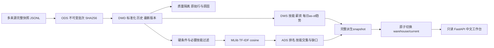

# BATCH ANALYTICS · 招聘离线数仓与 AI 岗位匹配

一个独立运行的 PySpark 项目：把多来源岗位快照整理为 ODS / DWD / DWS / ADS 四层分区 Parquet，先检查实习类型、学历、届别、位置与显式必要技能，再使用 **Spark MLlib TF-IDF** 排序，并在中文工作台展示技能、薪资、排除原因和证据。

**默认数据与公司全部虚构。** 公开画像是匿名教学示例，与任何个人简历无关。翻身地铁站只是公共筛选中心示例，不表示住址。没有网站抓取、自动投递、简历上传或外部模型调用。

## 快速开始

环境：Python 3.12、Java 17 或 21、[uv](https://docs.astral.sh/uv/getting-started/installation/)。在 macOS 自动发现 JDK，Linux 使用 `JAVA_HOME` 或 PATH 中的 Java。资源建议：2 个 CPU 核、约 2–3 GB 可用内存；测试环境为 `local[2]`。

```bash
# 在仓库根目录
make install        # 使用 requirements.lock 的精确版本；首次安装需要网络
make run            # 真实 Spark 首跑；后续相同输入直接命中缓存
make verify         # Spark 全链路、重复运行和缓存证据
make test           # Spark 边界/恢复测试 + API 测试
make serve          # http://127.0.0.1:8767
```

`./run-demo.sh`、`./scripts/test.sh`、`./serve.sh` 均可直接运行。健康环境只检查已安装的锁定版本，重复启动不重新安装；依赖缺失或版本不符会使用 uv 修复。`requirements.lock` 固定全部 Python 传递依赖，`pyproject.toml` 记录项目与开发依赖，服务没有另一个项目或父目录依赖。

不运行 Spark 也可以 `make serve`：API 显示 `examples/report.json` 的**公开虚构样例**，页面明确提示本次没有执行管道。运行管道后自动切换为本机已提交结果；样例不冒充当前运行数据。端口可用 `PORT=8768 ./serve.sh` 修改。

## 需求与使用场景

同一个岗位可能来自多个导出源，薪资写成日薪、月薪或年薪，岗位会更新或关闭，旧数据会晚到。直接关键词排序容易混入不符实习、届别、位置或必要技能的岗位，也难以解释某个岗位为何入选。

本项目处理完整快照与时间版本，隔离脏数据、保留原始来源，生成技能需求与薪资统计。机器学习只对结构化规则已通过的岗位排序。0–1 相似度**不是录用概率**，也不验证技能熟练度或经历。`skills` 只是未分级标签；只有显式 `required_skills` 参与技能硬过滤，`preferred_skills` 不阻止入选，没有让 LLM 猜测招聘要求。

## 架构与落地内容



| 层/目录 | 粒度与分区 | 作用 |
| --- | --- | --- |
| `warehouse/ods` | 原始行；batch_id / snapshot_date / source | 原文、来源、哈希和批次提交 |
| `warehouse/current/dwd/job_history` | 一条有效版本；snapshot_date / source | 规范化、语义版本去重、追溯 |
| `warehouse/current/dwd/job_latest` | 一个业务岗位；status / role | 源内最新与跨源去重、关闭语义 |
| `warehouse/current/dws` | 日期/技能或角色；as_of_date | 技能需求、薪资汇总、SQL LAG趋势 |
| `warehouse/current/ads/job_matches` | 画像/岗位；profile_id / snapshot_date | 硬筛选后的全部排名 |
| `warehouse/current/models/tfidf` | Spark PipelineModel | CountVectorizer / IDF / L2 Normalizer |
| `artifacts/report.json` | 指向已提交快照 | 最多导出50条匹配和有限聚合 |
| `artifacts/last-run.json` | 本次执行状态 | 缓存命中、重建行数、耗时 |

## 0.2.0 的实质优化

**避免相同批次重复重算。** 缓存指纹包括累计 ODS 批次 SHA-256、完整画像和 `src/*.py` 源码 SHA。相同输入、画像、代码且快照文件完整时，不再训练模型或重建派生层；普通 CLI 缓存命中甚至不启动 Spark JVM。执行状态可在 `last-run.json` 和 `/api/jobs.execution` 查看 `cache_hit=true`、`derived_rows_rebuilt=0`。

**失败不破坏上一成功结果。** DWD / DWS / ADS、隔离表、模型、报告、计划先写入 staging，全部成功后重命名为不可变 snapshot，再原子切换 `warehouse/current`。缓存保存完整文件 SHA 清单；报告或模型文件缺失/损坏时重建。发布前失败保持原先 current 与报告。ODS 已提交新批次会保留，下次继续重建。

这仍是 **ODS 批次增量 + 有变化时派生层全量重建 + 无变化时跳过**，不是行级增量 merge，也不是 ACID 表格式。单写者使用文件锁；当前目录切换只保证本机同磁盘的发布边界，多文件消费者应先固定 `current.resolve()` 再读取。本版本保留旧快照用于检查；长期运行需要设置保留期。

**解释筛选边界。** `exclusion_summary` 按最新岗位汇总被排除的原因，原因可重叠，不可直接求和。每条匹配保留显式必要技能、偏好技能、对应缺口和结构化条件；自由文本只影响相似度，不改变资格判断。

## 自有授权输入

详细字段见 [数据字典](docs/DATA_CONTRACT.md)，示例一行一个 JSON。新文件名就是新批次 ID，仅使用字母、数字、连字符与下划线。

```bash
./run-demo.sh --input ./my-authorized-input --profile ./config/profile.local.json
```

已提交批次内容不可修改：相同 ID 同内容跳过，不同内容失败；修正与补数使用新 ID。ODS 是累计注册表，删除输入文件不等于删除历史。独立数据集使用新的 `--warehouse` 和 `--artifacts`，避免与默认样例混合。真实画像请保存在被忽略的 `config/*.local.json` 中，不提交身份信息、联系方式或住址。

快照按事件时间 `snapshot_ts` 确定最新版本；旧日期补数不会复活已关闭岗位。跨源指纹基于公司、标题、地址与城市，是近似业务键；同名同地址岗位可能合并，真实接入应提供统一岗位 ID。

## 验证与接口

本机真实 Spark 与 API 结果见 [公开验收摘要](evidence/validation.json)。运行后完整证据在 `artifacts/verification.json`、`test-results.xml`、`spark-plan.txt`、`partition-pruning-plan.txt`。CI 使用 Ubuntu、Python 3.12、Java 21，实际执行所有 Spark/API 测试和全链路验收；没有用静态截图代替数据处理。

| 接口 | 用途 |
| --- | --- |
| `GET /health` | 版本与存活状态 |
| `GET /api/jobs` | 报告、样例状态、本次缓存状态 |
| `GET /api/overview` | 简要指标与数据模式 |
| `POST /api/explain` | `{ "item_id": "job_id" }`，只返回本地证据 |

关键测试覆盖薪资换算、5公里包含边界、坐标体系和未知值、届别与学历、关闭后补数、跨源去重、不可变批次、必要/偏好技能、画像和代码指纹、模型缺失恢复、发布前失败保留上一结果，以及空语料/空匹配/API损坏数据。

## 局限与后续

默认是数百条合成快照的本机功能验证，不能证明生产吞吐或真实推荐准确率。日薪折算按21.75天/月、8小时/天、12月/年；保留原文，未知金额不填0。距离为同一 GCJ02 坐标体系的直线距离，未知位置或届别保守排除。TF-IDF 不理解完整履历或证明招聘资格。

完整难点与口径见 [工程设计](docs/PROJECT.md)；版本记录和可行动路线见 [CHANGELOG](CHANGELOG.md)。依赖 API 参考 [Spark 4.0.1 官方安装说明](https://spark.apache.org/docs/4.0.1/api/python/getting_started/install.html) 与 [MLlib TF-IDF](https://spark.apache.org/docs/4.0.1/ml-features.html#tf-idf)。
